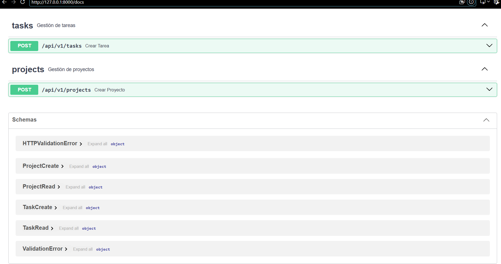

# Práctica 1.3 — Organización con APIRouter

**Proyecto:** Taskflow API
**Objetivo:** separar las rutas por recurso usando `APIRouter`, de modo que `main.py` solo instancie y configure la aplicación.

## Estructura de carpetas

```
Taskflow/
├── app/
│   ├── __init__.py
│   ├── main.py            # Instancia FastAPI, configura tags e incluye los routers
│   ├── schemas.py         # Modelos Pydantic (TaskCreate, TaskRead, ProjectCreate, ProjectRead)
│   └── routers/
│       ├── __init__.py
│       ├── tasks.py       # APIRouter(prefix="/tasks", tags=["tasks"])
│       └── projects.py    # APIRouter(prefix="/projects", tags=["projects"])
├── Dockerfile
├── requirements.txt
└── practica1.md
```

## Qué hace cada archivo

| Archivo | Responsabilidad |
|---|---|
| `app/main.py` | Crea la app, define `openapi_tags` (descripción de cada grupo en Swagger) e incluye los routers con `include_router`. No contiene ninguna ruta de negocio. |
| `app/routers/tasks.py` | Endpoints del recurso tareas. |
| `app/routers/projects.py` | Endpoints del recurso proyectos. |
| `app/schemas.py` | Esquemas de entrada y salida de la API. |

## Endpoints

Los routers se registran con el prefijo de versión `/api/v1`, y cada uno añade el de su recurso:

| Método | Ruta | Descripción | Grupo en Swagger |
|---|---|---|---|
| POST | `/api/v1/tasks` | Crea una tarea | tasks |
| POST | `/api/v1/projects` | Crea un proyecto | projects |

Los nombres de los recursos van en plural y siguen la convención REST.

## Cómo se registran los routers

```python
app = FastAPI(title="Taskflow API", openapi_tags=tags_metadata)

app.include_router(tasks.router, prefix="/api/v1")
app.include_router(projects.router, prefix="/api/v1")
```

Dentro de cada router las rutas se declaran con `""` y no con `"/tasks"`, porque el prefijo ya está en el `APIRouter`. Si no, la ruta final sería `/tasks/tasks`.

## Cómo ejecutarlo

Desde la carpeta `Taskflow`, con el entorno virtual activado:

```bash
pip install -r requirements.txt
uvicorn app.main:app --reload
```

Después, abrir `http://127.0.0.1:8000/docs`. Deben aparecer los grupos **tasks** y **projects**.

## Verificación


