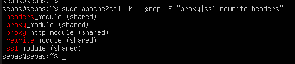
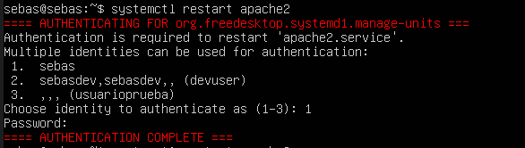

# Práctica 2.1 — Módulos de Apache

## 1. ¿Qué es un módulo de Apache y por qué hay que activarlos?

Un **módulo de Apache** es una extensión dinámica que añade funcionalidades específicas al núcleo del servidor web Apache HTTP Server sin necesidad de recompilarlo por completo. 

**¿Por qué es necesario activarlos?**
Por motivos de **seguridad y rendimiento**, Apache viene configurado por defecto únicamente con los módulos básicos indispensables para servir contenido estático. Cualquier característica avanzada (como actuar de proxy inverso, cifrar tráfico HTTPS o reescribir URLs) debe habilitarse explícitamente según las necesidades del proyecto.

---

## 2. Documentación de los módulos activados

### `proxy`
* **Propósito:** Proporciona la infraestructura básica para que Apache funcione como servidor proxy o pasarela (*gateway*), permitiendo redirigir peticiones de clientes hacia otros servidores internos o externos.
* **Ejemplo de configuración:**
  ```apache
  <IfModule mod_proxy.c>
      ProxyPreserveHost On
      ProxyRequests Off
  </IfModule>

### `proxy_http`
* **Propósito:** Proporciona la infraestructura básica para que Apache funcione como servidor proxy o pasarela (*gateway*), permitiendo redirigir peticiones de clientes hacia otros servidores internos o externos.
* **Ejemplo de configuración:**
  ```bash
  <VirtualHost *:80>
    ServerName mi-proyecto.local
    ProxyPass /api [http://127.0.0.1:8080/api](http://127.0.0.1:8080/api)
    ProxyPassReverse /api [http://127.0.0.1:8080/api](http://127.0.0.1:8080/api)
  </VirtualHost>

### `ssl`
* **Propósito:** Proporciona soporte para criptografía robusta mediante los protocolos SSL/TLS, permitiendo servir tráfico cifrado bajo HTTPS y gestionar certificados digitales.
* **Ejemplo de configuración:**
  ```bash
  <VirtualHost *:443>
    ServerName mi-proyecto.local
    SSLEngine on
    SSLCertificateFile /etc/ssl/certs/apache-selfsigned.crt
    SSLCertificateKeyFile /etc/ssl/private/apache-selfsigned.key
  </VirtualHost>

### `rewrite`
* **Propósito:** Ofrece un motor basado en reglas y expresiones regulares para manipular y reescribir URLs al vuelo. Se utiliza para crear URLs amigables (SEO), forzar redirecciones de HTTP a HTTPS o gestionar el enrutamiento en aplicaciones SPA (Single Page Applications).
* **Ejemplo de configuración:**
  ```bash
  <IfModule mod_rewrite.c>
    RewriteEngine On
    # Redirigir todo el tráfico HTTP a HTTPS
    RewriteCond %{HTTPS} off
    RewriteRule ^(.*)$ https://%{HTTP_HOST}%{REQUEST_URI} [L,R=301]
  </VirtualHost>

### `Headers`
* **Propósito:** Permite controlar, modificar, añadir o eliminar cabeceras HTTP tanto en las peticiones entrantes (Request) como en las respuestas salientes (Response). Es clave para implementar políticas de seguridad (CORS, HSTS, CSP) y control de caché.

* **Ejemplo de configuración:**
  ```bash
  <IfModule mod_headers.c>
    # Cabeceras de seguridad básicas
    Header always set X-Content-Type-Options "nosniff"
    Header always set X-Frame-Options "SAMEORIGIN"
  </IfModule>


## 3. Modulos extra relevantes en Apache

### `deflate`
* **Propósito:** Comprime las respuestas del servidor (HTML, CSS, JS, JSON) mediante Gzip antes de enviarlas al cliente, reduciendo el ancho de banda y mejorando los tiempos de carga.

### `security2`
* **Propósito:** Actúa como un WAF (Web Application Firewall), filtrando y bloqueando ataques comunes como inyecciones SQL (SQLi) o Cross-Site Scripting (XSS).

### `deflate`
* **Propósito:** Controla la generación de las cabeceras HTTP Expires y Cache-Control según el tipo de archivo, optimizando la caché del navegador.

### `deflate`
* **Propósito:** Proporciona protección preventiva frente a ataques de denegación de servicio (DoS/DDoS) y fuerza bruta bloqueando temporalmente IPs con exceso de peticiones.


## 4. Evidenia de verificaión




