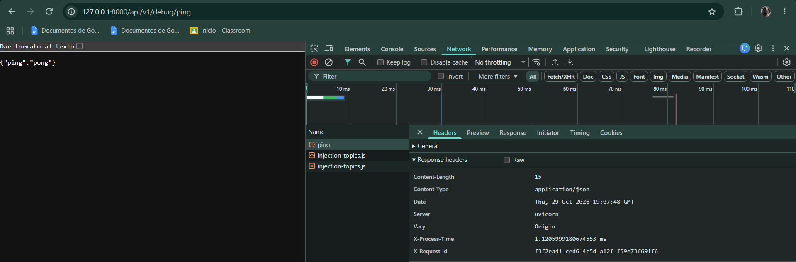
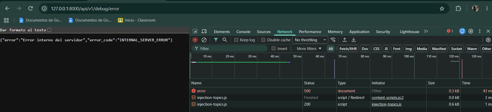
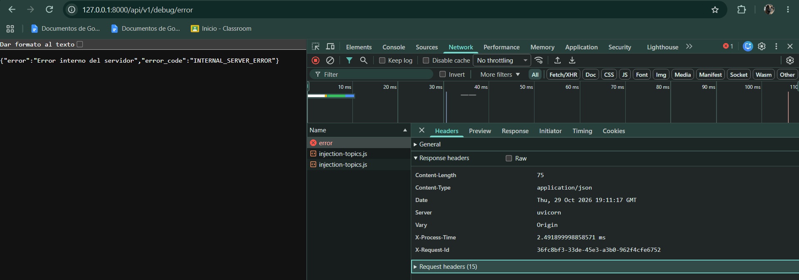

# Práctica 1.4 — Middleware

Objetivo: añadir comportamiento transversal (CORS, medición de tiempo, manejo global de errores) sin repetir código en cada endpoint.

## Estructura añadida

```
app/
├── main.py            
├── config.py          
├── middleware.py      
├── exceptions.py     
└── routers/
    └── debug.py      
```

## Qué es un middleware y en qué orden se ejecuta

Un middleware es código que envuelve todas las peticiones: ve la request antes de que llegue al endpoint y la response antes de que llegue al cliente. Permite implementar una vez un comportamiento que afecta a toda la API.

En FastAPI, el último middleware añadido es el más externo. La cadena queda así:

```
Petición ->  CORS -> request_id -> process_time -> endpoint
Respuesta <- CORS <- request_id <- process_time <- endpoint
```

| Middleware | Problema que resuelve | Por qué va en esa posición |
|---|---|---|
| CORSMiddleware | El navegador bloquea las peticiones del frontend (localhost:5173) a otro origen. | El más externo: así las respuestas de error también llevan cabeceras CORS y el navegador puede leerlas. |
| request_id_middleware | Sin identificador no se puede relacionar el error que ve el usuario con su línea en el log. | Fuera de process_time, para que el id ya exista cuando se registra un error. |
| process_time_middleware | Falta de visibilidad del rendimiento de cada petición. | El más interno: mide solo lo que tarda el endpoint y captura sus excepciones. |

## CORS

- Origen permitido: http://localhost:5173 (valor por defecto).
- En otros entornos se cambia con la variable CORS_ORIGINS, separando orígenes con comas, sin tocar el código.
- Métodos y cabeceras permitidos de forma explícita, sin comodines.
- expose_headers=["X-Process-Time", "X-Request-ID"]: el navegador oculta al JavaScript las cabeceras no estándar salvo que se expongan. Sin esto, el frontend no podría leer el tiempo de proceso ni el id de petición.

## Cabeceras añadidas

| Cabecera | Contenido |
|---|---|
| X-Process-Time | Tiempo de proceso de la petición en milisegundos. |
| X-Request-ID | UUID generado en el servidor para cada petición. No se acepta el del cliente, para que no pueda falsificarse ni inyectar texto en los logs. |

Las peticiones preflight (OPTIONS) las responde directamente CORSMiddleware por ser el más externo, así que no pasan por los middlewares propios.

## Manejo global de excepciones

Todas las respuestas de error usan el mismo esquema:

```json
{"error": "mensaje legible", "error_code": "CODIGO_ESTABLE"}
```

| Situación | Status | error_code |
|---|---|---|
| Excepción no controlada | 500 | INTERNAL_SERVER_ERROR |
| Error HTTP esperado (404, 405...) | el que corresponda | HTTP_<status> |
| Datos de entrada inválidos | 422 | VALIDATION_ERROR (incluye details) |

Por qué el middleware captura la excepción además de registrar el handler: Starlette ejecuta el handler de Exception en su capa más externa, por fuera de todos los middlewares. Una respuesta 500 generada ahí saldría sin X-Process-Time ni cabeceras CORS. Por eso process_time_middleware captura la excepción y reutiliza el mismo handler global: la respuesta 500 pasa por la cadena completa como cualquier otra.

## Seguridad en el manejo de errores

- El cliente solo recibe un mensaje genérico (Error interno del servidor). El stacktrace nunca se envía.
- El error completo (tipo, mensaje y stacktrace) se escribe en el log del servidor junto con el request_id. Se registra antes de construir la respuesta pública, así que el detalle siempre queda guardado aunque el cliente no lo vea.
- Con el X-Request-ID que recibe el cliente, un desarrollador localiza en el log el error exacto sin que esa información se exponga.

## Cómo comprobarlo

Con el servidor en marcha (uvicorn app.main:app --reload). En PowerShell hay que usar curl.exe, porque curl es un alias de otro comando:

```bash
# Respuesta normal: debe mostrar X-Process-Time, X-Request-ID y CORS
curl.exe -i -H "Origin: http://localhost:5173" http://127.0.0.1:8000/api/v1/debug/ping

# Excepción forzada: 500 con JSON limpio, y el servidor sigue vivo
curl.exe -i -H "Origin: http://localhost:5173" http://127.0.0.1:8000/api/v1/debug/error

# Origen no permitido: la respuesta no incluye Access-Control-Allow-Origin
curl.exe -i -H "Origin: http://evil.com" http://127.0.0.1:8000/api/v1/debug/ping
```

También se puede probar desde /docs (Swagger) y ver las cabeceras en Postman o en la pestaña Network de DevTools.

### Capturas

Cabeceras en una respuesta normal:



Error 500 forzado, sin stacktrace y con las mismas cabeceras:



