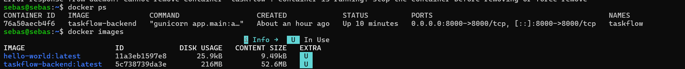

# Arquitectura: instalación directa vs. contenedor

## 1. Contenedor vs. máquina virtual

| Aspecto | Máquina virtual | Contenedor |
|---|---|---|
| **Aislamiento** | Fuerte: cada VM tiene su propio sistema operativo completo | Más ligero: comparte el kernel del sistema anfitrión, aislado por procesos |
| **Peso** | GBs (SO completo) | MBs (solo la aplicación y sus dependencias) |
| **Arranque** | Minutos | Segundos o menos |
| **Recursos** | Reserva CPU y RAM para todo el SO invitado | Consume solo lo que usa el proceso |
| **Portabilidad** | Imagen pesada, depende del hipervisor | La imagen funciona igual en cualquier máquina con Docker |

En esta práctica ambas tecnologías conviven: la **VM** (VirtualBox con Ubuntu) aporta el sistema operativo y el aislamiento del equipo anfitrión, y **Docker** corre dentro de ella para aislar la aplicación.

## 2. Instalación directa vs. contenedor

**Instalación directa:** Python, el entorno virtual y las dependencias se instalan en el sistema operativo y Gunicorn se lanza desde ahí.

**Contenedor:** una imagen Docker empaqueta Python, las dependencias y el código. El contenedor se crea a partir de ella.

| Criterio | Instalación directa | Contenedor |
|---|---|---|
| Preparación inicial | Instalar Python 3.13, crear el venv, instalar dependencias | Instalar Docker una vez; el resto lo define el `Dockerfile` |
| Reproducibilidad | Depende de la máquina ("en mi equipo funciona") | El mismo resultado en cualquier equipo |
| Aislamiento | Comparte librerías y Python con el sistema | Entorno propio e independiente |
| Despliegue / réplica | Repetir los pasos a mano en cada servidor | `docker run` con la misma imagen |
| Actualizar / revertir | Reinstalar o modificar el entorno | Nueva imagen; volver a la anterior es inmediato |
| Rendimiento | Máximo, sin capa intermedia | Casi idéntico, con una sobrecarga mínima |
| Complejidad | Menos conceptos que aprender | Hay que aprender Docker (imágenes, puertos, volúmenes) |
| Depuración | Acceso directo a archivos y procesos | Hay que usar `docker logs` y `docker exec` |
| Persistencia de datos | Natural, en el disco | Los datos del contenedor se pierden al eliminarlo salvo que se usen volúmenes |

### Ventajas e inconvenientes

**Instalación directa**
- Ventajas: simple, rápida para probar, rendimiento máximo, sin herramientas extra.
- Inconvenientes: difícil de reproducir, conflictos entre versiones de librerías, despliegues manuales y propensos a errores.

**Contenedor**
- Ventajas: entorno idéntico en desarrollo y producción, despliegue rápido, fácil de escalar y de revertir, no ensucia el sistema.
- Inconvenientes: curva de aprendizaje, la persistencia y la red requieren configuración, el seguimiento de la seguridad de las imágenes base es responsabilidad del equipo.

## 3. Aplicado a TaskFlow: ¿por qué Docker para el backend y no para el servidor web?

El **backend** (FastAPI + Gunicorn) es un buen candidato a contenedor porque:

- Tiene **dependencias concretas** (Python 3.13, FastAPI, Uvicorn, Gunicorn) que deben ser idénticas en todos los entornos.
- **Cambia con frecuencia**: cada versión del código genera una imagen nueva, fácil de desplegar y de revertir.
- Puede **replicarse** en varios contenedores si aumenta la carga.

El **servidor web** (por ejemplo Nginx como proxy inverso o para los archivos estáticos) suele instalarse **directamente** en el servidor porque:

- Es **estable**: se configura una vez y apenas cambia.
- Es el **punto de entrada** que escucha en los puertos 80 y 443 del servidor y gestiona el certificado HTTPS.
- Su instalación es simple y no tiene dependencias propias que puedan entrar en conflicto.

Es una decisión de diseño razonable, no una norma: Nginx también puede ejecutarse en un contenedor. Aquí se prioriza containerizar lo que más cambia y depende de su entorno.

## 4. Criterios de decisión: cuándo usar cada opción

| Situación | Opción recomendada |
|---|---|
| Prueba rápida o desarrollo individual muy sencillo | Instalación directa |
| Aplicación con varias dependencias y varios entornos (desarrollo, pruebas, producción) | Contenedor |
| Despliegues frecuentes o automatizados (CI/CD) | Contenedor |
| Varias aplicaciones en el mismo servidor con versiones distintas | Contenedor |
| Necesidad de rendimiento máximo con acceso directo al hardware | Instalación directa |
| Servicio estable de infraestructura (proxy, base de datos de un único servidor) | Instalación directa o contenedor, según el equipo |
| Escalar en la nube | Contenedor |

## 5. Qué aporta desplegar en la nube

Desplegar en la nube significa ejecutar la aplicación en infraestructura de un proveedor (AWS, Azure, Google Cloud…) y no en servidores propios.

- **Escalabilidad:** se añaden o quitan instancias según la demanda.
- **Disponibilidad:** el servicio se mantiene con redundancia y distribución geográfica.
- **Pago por uso:** no hay que comprar hardware por adelantado.
- **Servicios gestionados:** bases de datos, balanceadores, copias de seguridad y monitorización ya preparados.
- **Despliegue rápido:** se crea infraestructura en minutos.

**Relación con los contenedores:** la imagen Docker es la unidad estándar de despliegue en la nube. La misma imagen que se probó en la VM se ejecuta en servicios de contenedores del proveedor o en orquestadores como Kubernetes, sin cambios. Por eso el contenedor es el paso natural hacia la nube.

Inconvenientes: coste continuo si no se controla, dependencia del proveedor y necesidad de gestionar la seguridad y los permisos.

## 6. Ejemplo practico 

## 7. Conclusión

La instalación directa es válida para pruebas y casos simples, pero el contenedor ofrece reproducibilidad, aislamiento y despliegues repetibles, que son la base para trabajar en la nube. Para el backend de TaskFlow, que tiene dependencias concretas y cambia a menudo, Docker es la opción adecuada.