# Práctica 1.4 — Docker y primer contenedor: documento de pruebas

## 1. Instalación de Docker Engine

Se instala desde el repositorio oficial de Docker:

```bash
sudo apt update
sudo apt install -y ca-certificates curl
sudo install -m 0755 -d /etc/apt/keyrings
sudo curl -fsSL https://download.docker.com/linux/ubuntu/gpg -o /etc/apt/keyrings/docker.asc
sudo chmod a+r /etc/apt/keyrings/docker.asc
echo "deb [arch=$(dpkg --print-architecture) signed-by=/etc/apt/keyrings/docker.asc] https://download.docker.com/linux/ubuntu $(. /etc/os-release && echo "${UBUNTU_CODENAME:-$VERSION_CODENAME}") stable" | sudo tee /etc/apt/sources.list.d/docker.list > /dev/null
sudo apt update
sudo apt install -y docker-ce docker-ce-cli containerd.io docker-buildx-plugin docker-compose-plugin
```

### 1.1 Servicio activo y habilitado

```bash
sudo systemctl status docker
sudo systemctl enable docker
systemctl is-enabled docker
docker --version
```

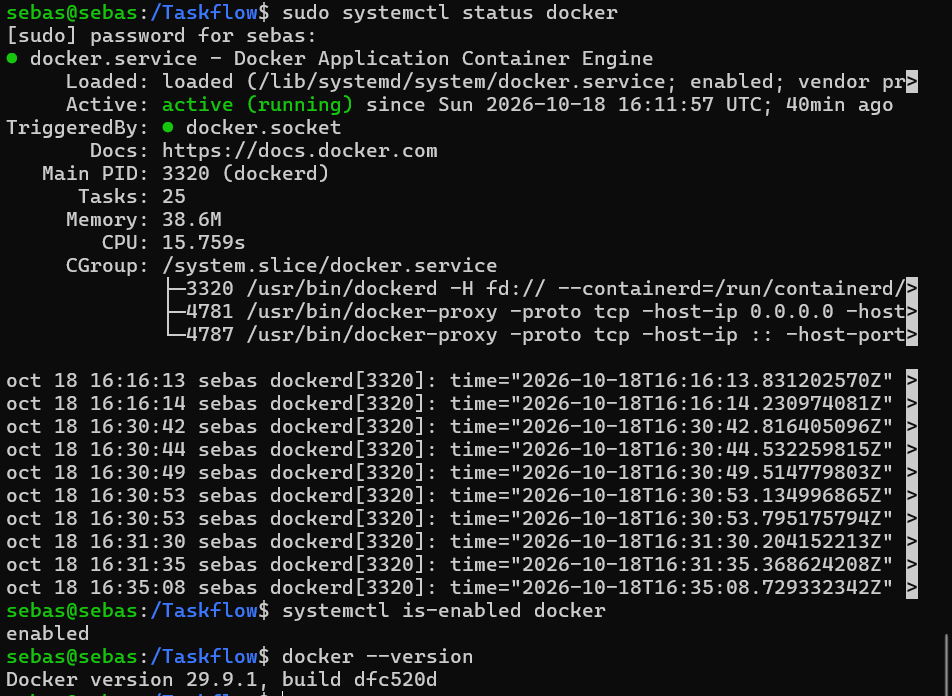

### 1.2 Post-instalación (usar Docker sin sudo)

```bash
sudo usermod -aG docker $USER
newgrp docker
groups
docker run hello-world
```

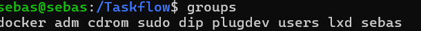
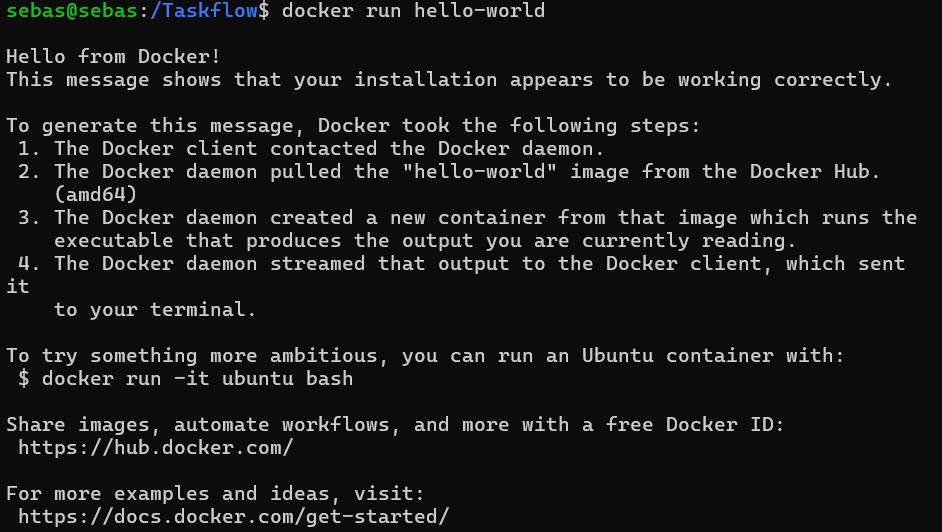

## 2. Dockerfile e imagen

### 2.1 Archivos

`Dockerfile`:

```dockerfile
FROM python:3.13-slim

WORKDIR /Taskflow

COPY requirements.txt .
RUN pip install --no-cache-dir -r requirements.txt

COPY app ./app

EXPOSE 8000

CMD ["gunicorn", "app.main:app", "--worker-class", "uvicorn.workers.UvicornWorker", "--bind", "0.0.0.0:8000"]
```

`.dockerignore`:

```
.venv/
__pycache__/
*.pyc
.git/
docs/
```

Dentro del contenedor se usa `--bind 0.0.0.0:8000` (y no `127.0.0.1`) para que el puerto sea accesible desde fuera del contenedor al publicarlo con `-p`.

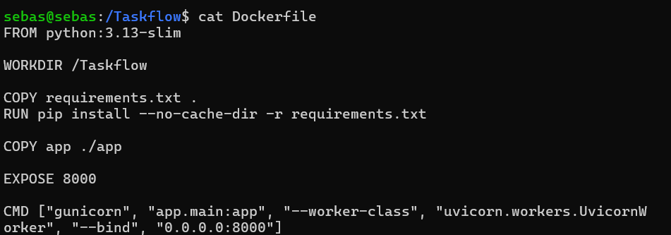
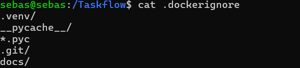

### 2.2 Construcción de la imagen

```bash
docker build -t taskflow-backend .
docker images
```


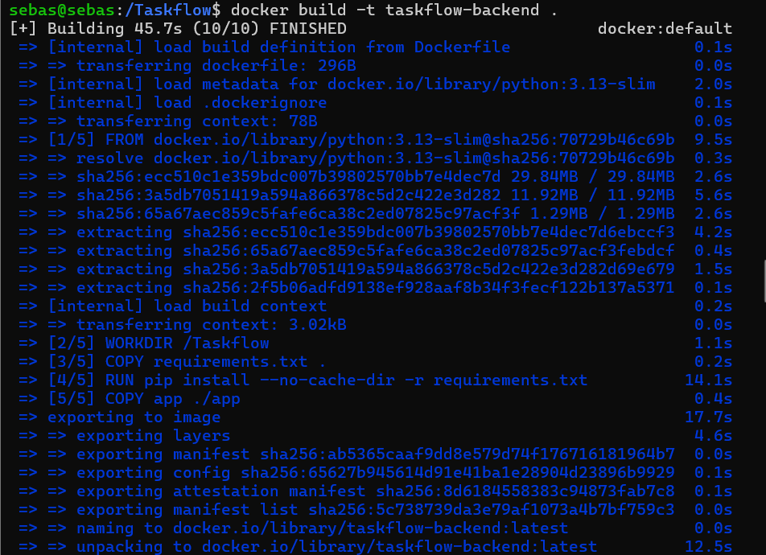
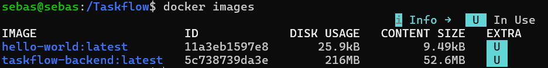

## 3. Arranque del contenedor

**Sentencia de arranque:**

```bash
docker run -d --name taskflow -p 8000:8000 taskflow-backend
```

| Opción | Significado |
|---|---|
| `-d` | Ejecuta el contenedor en segundo plano |
| `--name taskflow` | Nombre del contenedor |
| `-p 8000:8000` | Publica el puerto 8000 de la VM hacia el 8000 del contenedor |
| `taskflow-backend` | Imagen utilizada |

```bash
docker ps
docker logs taskflow
```

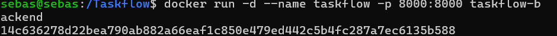
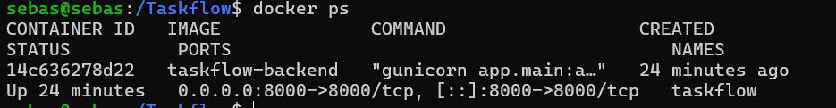
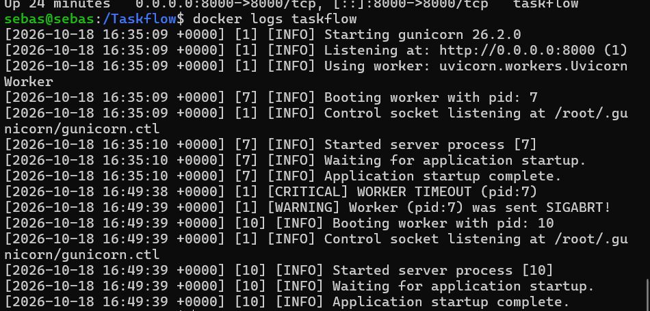

## 4. Verificación

### 4.1 Endpoints (desde la VM)

```bash
curl http://127.0.0.1:8000/health
curl http://127.0.0.1:8000/version
curl http://127.0.0.1:8000/ping
curl -I http://127.0.0.1:8000/docs
```

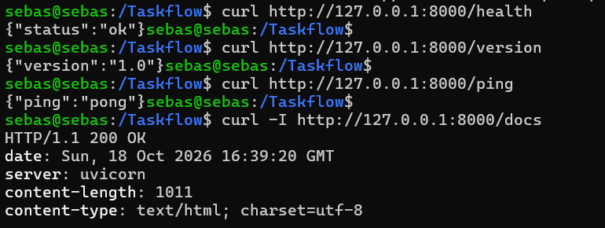

### 4.2 Swagger (`/docs`)

Acceso desde el navegador a `http://192.168.1.36:8000/docs`

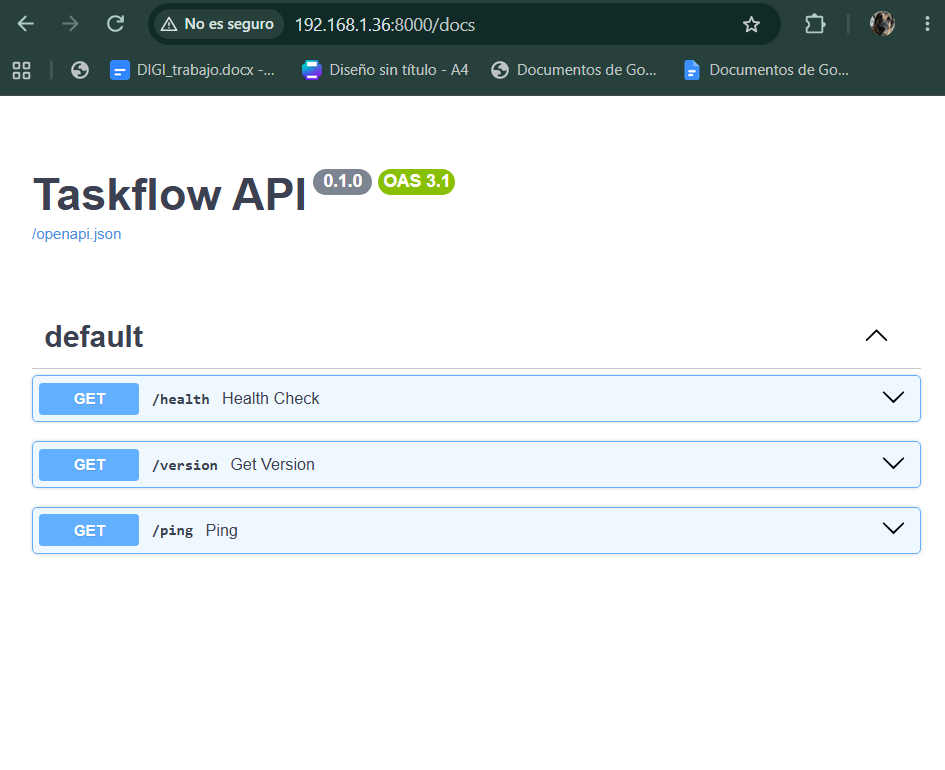

## 5. Ciclo de vida del contenedor

```bash
docker stop taskflow       # parar
docker ps -a               # aparece como Exited
docker start taskflow      # arrancar de nuevo
docker restart taskflow    # reiniciar
docker stop taskflow
docker rm taskflow         # eliminar
docker ps -a               # ya no existe
```

Después se vuelve a crear con la sentencia de arranque de la sección 3.


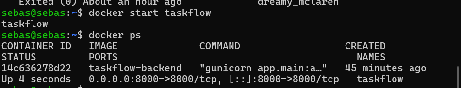
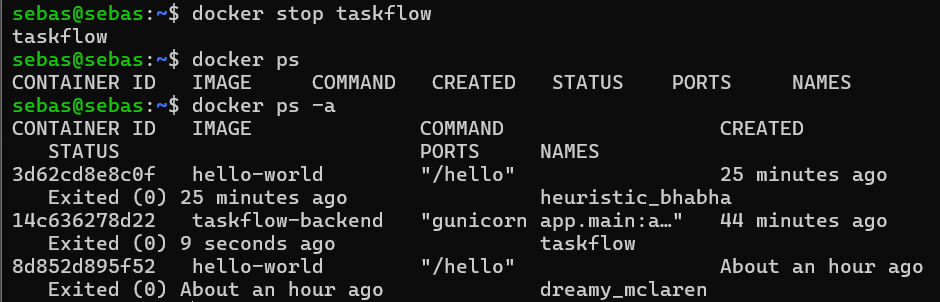
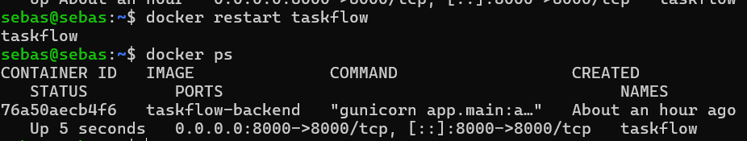
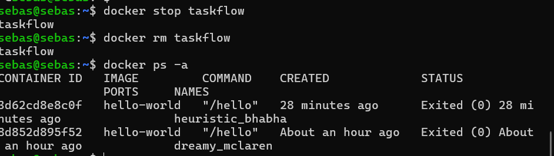

## 6. Conclusión

El backend de TaskFlow se ejecuta en un contenedor Docker construido desde un `Dockerfile`, responde en el puerto 8000 y expone Swagger en `/docs`. El contenedor se puede parar, reiniciar, eliminar y recrear en segundos con la misma imagen.
